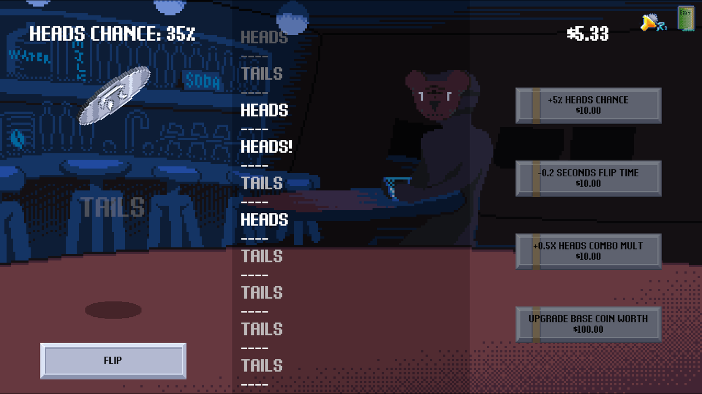

<div align="center">

# Unfair Flips: Loaded Coin

**If the coin won't play fair, neither will we.**

[](https://store.steampowered.com/app/3925760/)
[](https://github.com/WhoIsTyfur/unfair-flips-loaded-coin/releases/latest)
[](https://github.com/WhoIsTyfur/unfair-flips-loaded-coin/releases)
[](https://github.com/BepInEx/BepInEx)
[](#steam-deck-and-linux)
[](LICENSE)



A mod for **[Unfair Flips](https://store.steampowered.com/app/3925760/)** that flips the coin and buys upgrades for you, right inside the game.<br>
No mouse macros, no stolen cursor. Tab out and let it grind.

**[Download](https://github.com/WhoIsTyfur/unfair-flips-loaded-coin/releases/latest)** | **[Install guide](#install)** | **[Buy the game on Steam](https://store.steampowered.com/app/3925760/)**

</div>

---

## Why this exists

My first run was legit, and I'd recommend you do yours that way too. But Unfair Flips has several endings, and the game picks one at random each time you win. Nothing stops you from landing the same ending 50 times in a row, and grinding 10 heads in a row over and over just to roll the dice on a new one isn't very fun.

I'd had my fill of the game and just wanted the rest of the achievements. So I loaded the coin.

## Features

- **Auto flip:** flips the moment the coin is ready
- **Auto buy:** buys upgrades as soon as you can afford them, in priority order
- **Runs in the background:** keeps going while you're tabbed out, watching something or playing another game
- **Farms endings:** after the 10th heads, it waits out the ending, then starts a fresh run by itself, over and over
- **Hotkeys:** F8 pauses flipping, F9 pauses buying
- **Configurable:** change the buy order, or have it save up for your top pick

### Default buy order

| Priority | Upgrade |
|:---:|---|
| 1 | Coin Value |
| 2 | Heads Chance |
| 3 | Combo |
| 4 | Flip Time |

## Install

> **Windows**, with the Steam version of the game.

**Step 1: Download.** Grab `LoadedCoin-v1.2.0.zip` from the [latest release](https://github.com/WhoIsTyfur/unfair-flips-loaded-coin/releases/latest). It's under **Assets** at the bottom.

**Step 2: Open the game folder.** In your Steam Library, right-click **Unfair Flips**, then **Manage**, then **Browse local files**. A folder opens with `Unfair Flips.exe` in it.

**Step 3: Copy the files in.** Open the zip, select everything inside (`BepInEx`, `winhttp.dll`, `doorstop_config.ini`) and drag it into the game folder. If Windows asks, choose **Replace**.

Your game folder should now look like this:

```
Unfair Flips/
|-- BepInEx/              <- new
|-- MonoBleedingEdge/
|-- Unfair Flips_Data/
|-- doorstop_config.ini   <- new
|-- Unfair Flips.exe
|-- UnityCrashHandler64.exe
|-- UnityPlayer.dll
`-- winhttp.dll           <- new
```

**Step 4: Play.** Launch the game from Steam like normal. The coin starts flipping on its own.

> [!IMPORTANT]
> `winhttp.dll` must sit **right next to** `Unfair Flips.exe`. If you end up with a `LoadedCoin-v1.2.0` folder inside the game folder, open it and move everything inside up one level.

> [!NOTE]
> **Upgrading from v1.0.0?** Delete `BepInEx/plugins/UnfairFlipsAutoFlip.dll`, or both versions will run at once.

## Controls

Click the game window first, then:

| Key | Action |
|:---:|---|
| `F8` | Auto flip on / off |
| `F9` | Auto buy on / off |

Both start **on**.

## Settings

The settings file is created the first time you launch with the mod:

```
Unfair Flips/BepInEx/config/tyfur.unfairflips.loadedcoin.cfg
```

Open it in Notepad, change a value, save, and restart the game.

| Setting | Default | What it does |
|---|---|---|
| `AutoFlip` | `true` | Flip automatically |
| `AutoBuy` | `true` | Buy upgrades automatically |
| `Priority` | `FlipBaseWorth,HeadsChance,FlipMultiplier,FlipTime` | Buy order. `FlipBaseWorth` is Coin Value, `FlipMultiplier` is Combo |
| `AutoRestart` | `true` | Start a new run automatically after an ending |
| `RestartDelay` | `5` | Seconds to stay on the end screen before restarting |
| `SaveForTop` | `false` | `false`: buy the highest-priority upgrade you can afford. `true`: save up for the first unmaxed upgrade on the list and buy nothing else until you have it |
| `ToggleFlip` | `F8` | Hotkey for auto flip |
| `ToggleBuy` | `F9` | Hotkey for auto buy |

## Uninstall

Delete these three from the game folder: the `BepInEx` folder, `winhttp.dll` and `doorstop_config.ini`. Your save is never touched.

## Troubleshooting

<details>
<summary><b>Nothing happens when I start the game</b></summary>

`winhttp.dll` is almost always in the wrong place. It must be in the same folder as `Unfair Flips.exe`. After one launch there should be a file at `BepInEx/LogOutput.log`. If it isn't there, the mod didn't load.
</details>

<details>
<summary><b>My antivirus flagged <code>winhttp.dll</code></b></summary>

That file is [BepInEx](https://github.com/BepInEx/BepInEx), the most widely used mod loader for Unity games. It loads mods by sitting next to the game's exe, which some antivirus programs find suspicious. It's a false positive, and the source for BepInEx and for this mod is fully public.
</details>

<details>
<summary><b>The hotkeys don't work</b></summary>

They only work while the game window is focused. Click the game, then press F8 or F9.
</details>

<details id="steam-deck-and-linux">
<summary><b>Steam Deck and Linux</b></summary>

Install the same way. Then in Steam, right-click the game, choose **Properties**, and set **Launch Options** to:

```
WINEDLLOVERRIDES="winhttp=n,b" %command%
```

macOS isn't supported.
</details>

## How it works

Loaded Coin is a [BepInEx 5](https://github.com/BepInEx/BepInEx) plugin. Every frame, it checks the same conditions the game uses for the Space key. When the coin is ready, it calls the game's own flip code. Once the shop is open, it presses the next upgrade on your list through the game's own button code, so every purchase runs exactly as if you'd clicked it. No memory editing and no fake input.

## Building from source

Requires the [.NET 8 SDK](https://dotnet.microsoft.com/download/dotnet/8.0) and the game with BepInEx installed, since the build references the game's DLLs.

```
dotnet build -c Release
```

If the game isn't in the default Steam folder:

```
dotnet build -c Release -p:GamePath="D:\SteamLibrary\steamapps\common\Unfair Flips"
```

Copy `bin/Release/netstandard2.1/LoadedCoin.dll` into `Unfair Flips/BepInEx/plugins/`.

## Credits

- **Unfair Flips** is by Heather Flowers. [Buy it on Steam](https://store.steampowered.com/app/3925760/) and play it legit first; it's worth it. This mod isn't affiliated with or endorsed by the developer.
- The release zip bundles [BepInEx](https://github.com/BepInEx/BepInEx) under LGPL-2.1 (see `BepInEx/LICENSE-BepInEx.txt`).
